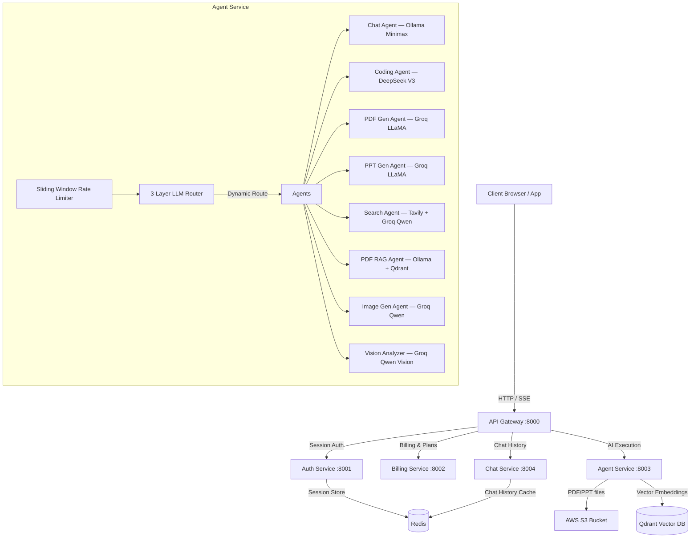
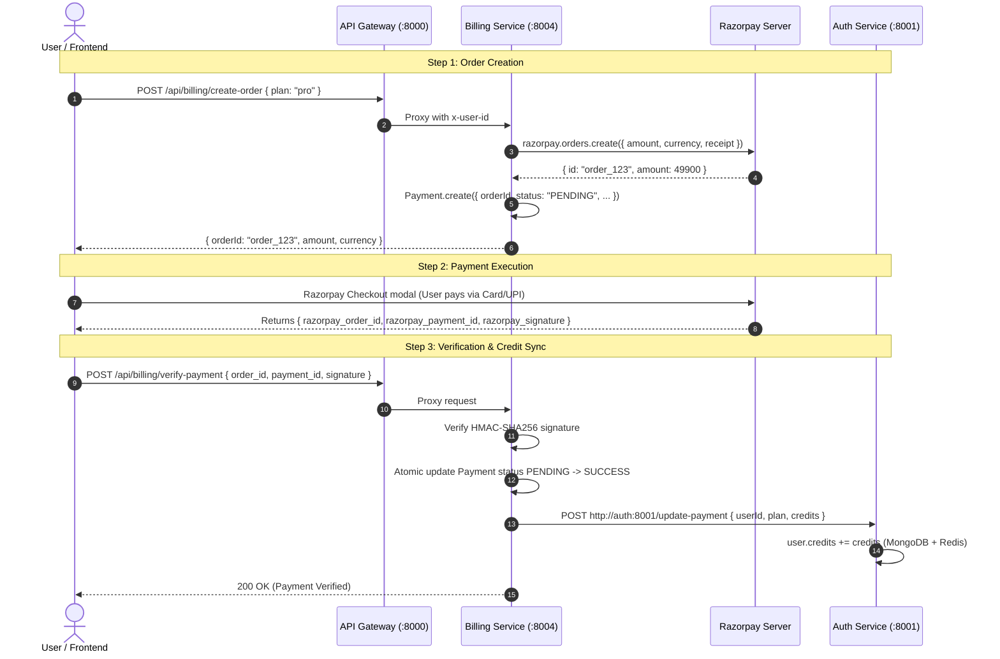
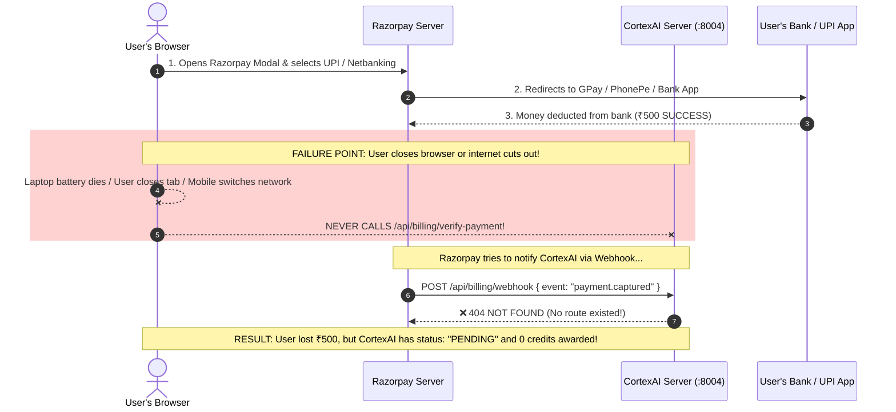
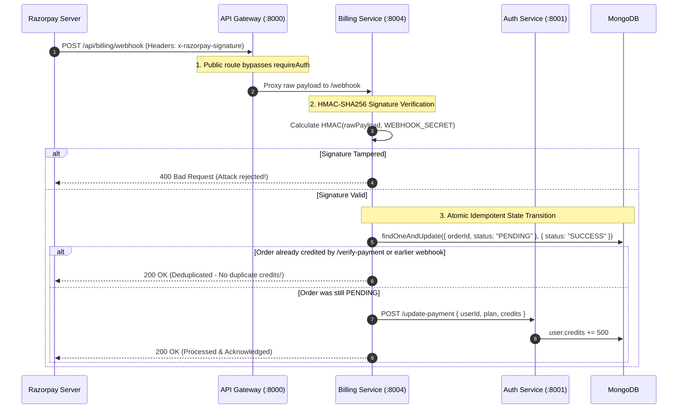

# CortexAI — Agentic AI SaaS Platform

https://github.com/user-attachments/assets/ff6c07df-7e9d-4c67-9011-3ef20b993f16

> **Tech Stack:** `LangGraph` • `LangChain` • `Qdrant` • `Redis` • `BullMQ` • `Docker` • `AWS S3` • `Razorpay` • `Node.js` • `Express` • `React`

CortexAI is a production-grade, credit-based **Agentic AI SaaS Platform** powered by a distributed microservices architecture and dynamic multi-agent orchestration. It coordinates specialized AI agents using **LangGraph** and **LangChain** to handle conversational chat, code generation, live web search, PDF & PPT document generation, PDF RAG (Retrieval-Augmented Generation) with Qdrant embeddings, image generation, and multimodal vision analysis — complete with real-time **SSE token streaming**, **BullMQ async queues**, and **Redis sliding-window rate limiting**.

---

## 📄 Resume Summary & Key Highlights
* **Distributed Microservices Architecture:** Architected a 4-service microservices platform (API Gateway, Auth, Billing, Chat, Agent) with Redis session sync, handling **100/100 concurrent payment replays** with atomic MongoDB deduplication, sub-millisecond sliding-window rate limiting (100 req/min with UUID collision prevention), and **fail-open fault isolation** (p50=3,023ms under Redis outage).
* **High-Performance End-to-End RAG Pipeline:** Engineered a production RAG system over a **468k-character corpus** (1,380 chunks) using Ollama `nomic-embed-text:v1.5` and Qdrant; implemented cross-encoder reranking (`ms-marco-MiniLM-L-6-v2`) on top-20 dense candidates, doubling **Recall@5 from 41.18% to 82.35%** (Wilson 95% CI: [59.0%, 93.8%], MRR: 0.7402, paired bootstrap p<0.01) and lifting **End-to-End QA correctness from 51.0% to 82.4%** with **95.2% faithfulness** and **100% refusal accuracy**.
* **Async Job Queues & Multi-Agent Orchestration:** Orchestrated 8 LangGraph stateful agents (Chat, Coding, Web Search, RAG, Image Analysis, Image Gen, PDF Gen, PPT Gen) with real-time SSE token streaming and BullMQ background queues for asynchronous >10MB document processing.

## 🏛️ System Architecture

CortexAI is structured as an ecosystem of decoupled microservices coordinating via an API Gateway:



---

### 1. Services Breakdown

* **API Gateway (`gateway`)**: The single entry point. Handles routing, session authentication, and passes custom headers (like user context) to internal microservices via `proxyWithHeader`. Uses `parseReqBody: false` for raw binary stream forwarding.
* **Auth Service (`auth`)**: Handles Firebase authentication, user management, and exposes credit verification and credit deduction endpoints (`/deduct-credit`). Syncs credit balance back to all active Redis sessions after each deduction.
* **Billing Service (`billing`)**: Manages pricing plans (Pro/Business), Razorpay order creation, HMAC-SHA256 signature verification, payment recording, and credit top-up via Auth Service.
* **Chat Service (`chat`)**: Maintains conversation records and message history in MongoDB. Implements Redis cache layer (`chat:history:{id}`, 30-minute TTL). When a chat is deleted, purges MongoDB messages and deletes Redis keys (`chat:history:{id}` and `pdf:collection:{id}`).
* **Agent Service (`agent`)**: The core cognitive engine. Orchestrates multiple specialized LLM agents using a LangGraph StateGraph workflow with real-time SSE streaming. Features **BullMQ + Redis background queues** (`pdf-rag-queue`, `ppt-gen-queue`, `pdf-gen-queue`) for processing 10MB+ files asynchronously.

### 2. Model Dispatcher & Routing (`config/model.js`)

| Agent Role | Model Assigned | Provider | Purpose |
| :--- | :--- | :---: | :--- |
| `chatAgent` | `minimax-m3:cloud` | **Ollama** (local) | General conversational assistant — no API cost |
| `codingAgent` | `deepseek/deepseek-chat` | **OpenRouter** | Advanced code generation & technical tasks |
| `pdfAgent` | `llama-3.3-70b-versatile` | **Groq** | Structured PDF content generation (temp: 0) |
| `pptAgent` | `llama-3.3-70b-versatile` | **Groq** | Structured presentation slide generation (temp: 0) |
| `pdfRagAgent` | `minimax-m3:cloud` | **Ollama** (local) | Document Q&A with strict grounding — no API cost |
| `searchAgent` | `qwen/qwen3.6-27b` | **Groq** | Intent classification & web search routing (thinking model) |
| `imageAgent` | `qwen/qwen3.6-27b` | **Groq** | Image prompt generation |
| `imageAnalyzer` | `qwen/qwen3.6-27b` | **Groq Vision** | Multimodal VQA, OCR, and image understanding (temp: 0.2) |

---

## 🧠 Cognitive Orchestration (LangGraph Workflow & BullMQ Queues)

The **Agent Service** processes user queries dynamically through a StateGraph with BullMQ background queueing:

1. **Routing (`router` Node)**: 3-layer classification — manual selection → keyword heuristics → Ollama LLM fallback. Determines agent type before any LLM call.
2. **10MB+ BullMQ Auto-Queueing**: Large PDF uploads (>10MB up to 100MB) are automatically enqueued to BullMQ `pdf-rag-queue`. The background worker (`pdfRagWorker`) handles parsing, text splitting, Qdrant vector embedding, and LLM RAG answer generation, notifying the controller via `QueueEvents`.
3. **Explicit Web Search Intent Bypass**: When a prompt contains explicit web search keywords (`"from net"`, `"from web"`, `"google"`, `"online"`, `"tavily"`), the router bypasses active PDF session keys in Redis and routes directly to `searchAgent`.
4. **Sliding Window Rate Limiter**: Redis sorted-set rate limiter runs before agent execution. Returns `HTTP 429` with exact `retryAfterSeconds` if limit exceeded.
5. **Credit Gate**: Auth Service called to deduct credits for the specific agent before starting the LangGraph stream.
6. **Execution & SSE Streaming**: `graph.streamEvents({ version: "v2" })` streams thinking logs and output tokens token-by-token to the client.

---

## ✨ Features

### 🤖 Multi-Agent AI Orchestration
- **8 Specialized Agents** — Chat, Coding, Search, PDF Generation, PPT Generation, PDF RAG, Image Generation, Image Analysis
- **3-Layer Intelligent Router** — Manual selection → Keyword heuristics → Local LLM fallback (Ollama Minimax, no API cost)
- **LangGraph StateGraph** — Directed acyclic graph workflow with conditional edges (e.g. searchAgent → codingAgent chain)
- **BullMQ + Redis Background Workers** — Async job queues (`pdf-rag-queue`, `ppt-gen-queue`, `pdf-gen-queue`) for heavy 10MB+ document processing
- **Real-time SSE Streaming** — Token-by-token streaming with `X-Accel-Buffering: no` for Nginx compatibility

### 💬 Conversational Chat (chatAgent)
- Powered by **Ollama Minimax** (local, no API cost, no rate limits)
- Multi-turn conversation history with full context window
- SFW content guardrails — filters adult content from search-augmented responses
- Auto-generated conversation titles (fire-and-forget, parallel to stream)
- Live date/time injection for time-sensitive queries

### 💻 Code Generation (codingAgent)
- Powered by **OpenRouter DeepSeek V3** (`temperature: 0`, 8192 max tokens)
- Produces multi-file artifacts (HTML, CSS, JS, React components)
- Artifacts rendered in Monaco Editor with live preview iframe
- Automatic artifact drawer opens on code generation

### 🔍 Web Search (searchAgent)
- **Tavily Search API** — top 5 results with images (`includeImages: true`, `autoParameters: true`)
- **Multi-Turn Entity & Pronoun Resolution** — resolves pronouns (`him`, `his`, `he`, `she`, `this person`) by scanning previous **user message history** (e.g., resolving *"search details about him"* to *"Rishabh Jain"*)
- **Stop-Word Search Fallback** — converts queries containing only stop-words (`"from net"`, `"search"`, `"details"`) into the active entity subject from chat history
- Smart query cleaning — strips conversational prefixes ("make a pdf about...", "generate resume for...") before sending to Tavily
- Image deduplication with `Set` — no duplicate URLs in results
- Strict post-search routing — requires explicit PDF creation verbs (`"create pdf"`, `"make pdf"`) to route to `pdfAgent`; general queries (e.g., *"give details in pdf from net"*) summarize findings via `chatAgent`

### 📄 PDF Document Generation (pdfAgent)
- Groq LLaMA 70B structured JSON generation → rendered PDF
- `<think>` block streaming to ThoughtBox UI — users see reasoning in real time
- PDF download via AWS S3 pre-signed URLs

### 📊 PPT Slide Generation (pptAgent)
- Full slide deck generation with structured JSON → PPTX rendering
- Same ThoughtBox reasoning UI as pdfAgent
- AWS S3 export support

### 📖 PDF RAG — Document Q&A (pdfRagAgent)
- **`pdf-parse` ingestion** → regex page footer cleanup (`-- 2 of 9 --`) → noise chunk filter (< 30 chars)
- **`RecursiveCharacterTextSplitter`** — `chunkSize: 1200`, `chunkOverlap: 250`
- **Qdrant Vector DB** embedding exclusively via local Ollama **`nomic-embed-text:v1.5`** (768-dim vectors, fast local inference, no cloud API cost)
- **100MB File Upload Limit** — supports large documents up to 100MB
- **BullMQ Auto-Queueing** — 10MB+ PDFs processed asynchronously via `pdf-rag-queue` background worker
- **Top-10 similarity search** context injection into grounded LLM prompt
- **Multi-turn history** — follow-up questions remember previous RAG turns (no re-upload needed)
- Fallback query when no prompt provided: `"Summarize the key contents..."`

### 🖼️ Image Generation (imageAgent)
- Groq Qwen prompt enhancement → Stable Diffusion / DALL-E generation
- Generated images streamed back to frontend via SSE

### 👁️ Vision Analysis (imageAnalyzer)
- **Groq Qwen 3.6-27B Vision** multimodal model
- OpenAI-compatible `image_url: { url: "data:image/png;base64,..." }` payload format
- `<think>` reasoning preserved → ThoughtBox UI renders model's visual reasoning
- Supports JPG, PNG, WEBP, GIF, BMP, SVG uploads

### ⚡ BullMQ & Redis Background Queues
CortexAI features an asynchronous job queue system built on **BullMQ** and **Redis** ([`agentQueues.js`](backend/services/agent/queues/agentQueues.js)):

| Queue Name | Worker Name | Trigger Condition | Execution |
|:---|:---|:---|:---|
| `pdf-rag-queue` | `pdfRagWorker` | Large PDF Uploads (> 10MB up to 100MB) | Async PDF parsing, chunking, local `nomic-embed-text:v1.5` vector indexing into Qdrant, and LLM RAG response generation |
| `ppt-gen-queue` | `pptWorker` | Slide deck generation | Async PPTX rendering and S3 upload |
| `pdf-gen-queue` | `pdfGenWorker` | Report generation | Async PDF rendering and S3 upload |

- **Queue Events Synchronization** — `pdfRagQueueEvents` tracks job state (`active`, `completed`, `failed`). The controller waits via `job.waitUntilFinished(pdfRagQueueEvents)` and streams the completed answer over SSE.

---

## 🔒 Security & Rate Limiting

### Session-Based Authentication
- **Firebase ID Token** verification via Firebase Admin SDK
- **Redis session store** with 5-day TTL — `HttpOnly`, `Secure`, `SameSite: lax` cookies (XSS + CSRF protection)
- `requireAuth` middleware at Gateway level — all microservice routes protected

### Credit-Based Usage Control
Each agent request deducts credits from the user's balance before execution:

| Agent | Credits/Request |
|:---|:---:|
| chatAgent | 1 |
| searchAgent | 5 |
| codingAgent, pdfAgent, pptAgent, pdfRagAgent, imageAnalyzer | 10 |

Credits checked and deducted via Auth Service before LangGraph stream starts. `HTTP 403` returned if insufficient.

### Redis Sliding Window Rate Limiter
A **per-user, per-agent sliding window rate limiter** using Redis Sorted Sets — implemented in [`Agentlimit.js`](backend/services/agent/config/Agentlimit.js):

```
Algorithm: ZADD → ZREMRANGEBYSCORE → ZCOUNT → EXPIRE → limit check
Window: 60 seconds | Key: ratelimit:{userId}:{agentName}
```

| Agent | Requests/min |
|:---|:---:|
| chatAgent, pdfRagAgent | 20 |
| imageAnalyzer | 10 |
| searchAgent, codingAgent, pdfAgent, pptAgent, imageAgent | 5 |

- Returns `HTTP 429` with `retryAfterSeconds` calculated from oldest entry in window
- **Fail-open** — if Redis is down, requests pass through (app does not break)
- Sliding window prevents burst attacks (vs fixed window which allows 2× limit at window boundary)

---

## 🧠 3-Layer Intelligent Router

```
Layer 1: Manual agent selection (user UI panel)
    ↓ (if "auto")
Layer 1.5: File-type routing (.pdf → pdfRagAgent, image → imageAnalyzer)
    ↓
Layer 1.8: Active PDF Session Check (with explicit web search bypass)
    ↓ (if "auto" and no active PDF)
Layer 2: Deterministic keyword heuristics (O(n) regex, no LLM call)
    ↓ (no keyword match)
Layer 3: Ollama Minimax LLM classification with multi-turn chat history (local, no API cost, no rate limits)
```

- **Multi-Turn Chat History Ingestion** — Layer 3 passes recent 4 conversation turns into Ollama LLM classifier for context-aware routing decisions.
- **Explicit Web Search Intent Bypass** — prompts containing `"from net"`, `"form net"`, `"google"`, `"online"` bypass active Redis PDF sessions and execute web search.
- **Word-boundary regex** — prevents substring collisions (e.g. `"rate"` inside `"generate"`)
- **Topic indicators** — `"pdf about history"` → searchAgent (not pdfAgent)
- **File-type routing** — `.pdf` → pdfRagAgent, `image/*` → imageAnalyzer (before keyword check)
- **Dynamic import** for LLM fallback — avoids circular dependency with graph.js

---

## 🗠 File Attachments & Multimodal

### Upload Pipeline
- **Multer** file upload middleware — **100MB limit**, supports PDF + all image formats
- **Gateway proxy** — `parseReqBody: false` + `limit: "100mb"` preserves raw binary stream to Agent service
- File type detection: MIME type + file extension dual-check

### Chat Attachment Display
- **Image previews** — `URL.createObjectURL()` blob preview in user chat bubble (instant, before upload completes)
- **PDF badges** — `📄 document.pdf` attachment chip persists in chat history (saved to MongoDB)
- **Image persistence** — base64 data URI saved to MongoDB `images` field, reloaded on history fetch

### Frontend Attachment Input
- Attach button → `<input type="file" hidden>` → chip preview with thumbnail + file size
- FormData multipart for file uploads, JSON for text-only requests
- `Content-Type` boundary auto-set by browser (not manually set)

---

## 💡 ThoughtBox UI — Reasoning Visualization

Qwen and LLaMA models output `<think>...</think>` reasoning blocks before final answers. CortexAI captures and renders these in a collapsible **"Thought for Xs"** UI component:

- `<think>` tokens streamed live to ThoughtBox in real time
- Reasoning hidden from main response body — only clean answer shown below
- PDF/PPT agents: thinking streamed from `on_chat_model_stream`, JSON response from `on_chain_end`
- Timing shown: `"Thought for 4s"` — elapsed time calculated from first token to `</think>`

---

## 🗃️ Data Persistence Layer

### MongoDB (Chat History)
- `conversationModel` — userId, title, timestamps
- `messageModel` — role, content, images (base64), artifacts (JSON), pdf (S3 URL)
- Conversation titles auto-generated by LLM on first message (fire-and-forget parallel Promise)

### Redis Cache (Chat History)
- Cache key: `chat:history:{conversationId}` — 30-minute TTL
- Cache-hit serves history without MongoDB round-trip
- Cache updated on every `saveMessage` call — latest 20 messages kept
- Session sync on credit deduction — TTL preserved using `redis.ttl()` before overwrite

---

## 🖥️ Frontend — React + Redux

### Component Architecture
- **ChatArea** — conversation state, SSE stream consumer, 401/403 error handling
- **MessageArea** — markdown rendering, ThoughtBox, user image cards, PDF attachment badges
- **ChatInput** — agent selector toolbar (horizontally scrollable on mobile), file attachment chip
- **Artifact Drawer** — Monaco Editor + live HTML iframe preview
- **SideBar** — conversation list with create/delete
- **UpgradeModal** — Razorpay payment integration

### Mobile Responsiveness
- Artifact drawer: Full-width on mobile (`w-full`), side panel on desktop (`sm:w-[440px]+`)
- Dark backdrop blur overlay on mobile when drawer is open — tap outside to dismiss
- Agent toolbar: `overflow-x-auto scrollbar-none` horizontal scroll on small screens
- Touch-friendly controls — enlarged tap targets for mobile

### Redux State (conversationSlice)
- `conversations` — sidebar list
- `selectedConversationId` — active chat
- `selectedArtifact` + `isArtifactOpen` — artifact drawer state
- `updateArtifactFileContent` — Monaco editor live sync

---

## 📡 SSE Streaming Architecture

```
Frontend fetch() → Gateway → Agent Service → LangGraph streamEvents()
    ↓
on_chat_model_stream → token chunks → res.write("data: {...}\n\n")
on_chain_end         → final response / images / PDF / artifacts
    ↓
TextDecoder + buffer → partial line merging → JSON.parse → onChunk()
    ↓
React state update → UI re-render
```

Key headers for SSE:
```
Content-Type: text/event-stream
Cache-Control: no-cache
Connection: keep-alive
X-Accel-Buffering: no    ← Nginx must not buffer SSE responses
```

---

## 💳 Billing — Razorpay Integration

- Plan selection → Razorpay order creation → frontend Razorpay checkout widget
- HMAC-SHA256 signature verification on payment callback (`crypto.createHmac`)
- Payment record saved to MongoDB (`PENDING` → `SUCCESS`)
- Auth Service called post-payment to update user plan + credits in MongoDB AND Redis sessions

---

## 🎯 End-to-End RAG Answer Accuracy & Quality Benchmark

CortexAI contains a production-quality **End-to-End RAG Answer Accuracy & Quality Benchmark System**. This system measures the actual factual correctness and generation quality of final generated answers from real PDF documents, clearly separating chunking, retrieval, LLM answer generation, and end-to-end quality.

### 1. Evaluation Setup & Architecture

```
User Query
    ↓
PDF Ingest (pdf-parse v2) → Qdrant (Hybrid RRF: Vector + BM25)
    ↓
Retrieval (top-K chunks)
    ↓
pdfRag.agent.js (LLM generation with concise grounding prompt)
    ↓
Final Answer
    ↓
LLM-as-a-Judge (Evaluates Correctness, Faithfulness, Completeness, Relevance)
```

* **Dataset**: Synthetic 22-page ACME Employee Handbook PDF (25,699 chars, 51 chunks) and 74 curated QA pairs across 8 categories (factual, semantic, numerical, identifier, hard negative, temporal, multi-constraint, and unanswerable).
* **Splits**: Stratified split into **DEV** (26 questions for calibration) and **TEST** (48 questions held-out for frozen verification).
* **Evaluator Architecture Fix**: Corrected judge evidence window to receive the full top-K retrieved context rather than a single golden sentence. This eliminated false-positive hallucination penalties caused by evaluator truncation.

### 2. Production Benchmark Scorecard (DEV Split)

| Metric | Baseline (Pre-Fix) | Production Optimized | Δ Improvement |
| :--- | :---: | :---: | :---: |
| **Retrieval Hit@5** | N/A | **100.0%** | — |
| Retrieval MRR | N/A | **0.83** | — |
| Retrieval NDCG@5 | N/A | **0.88** | — |
| **Strict Answer Correctness Rate** | 87.0% (20/23) | **100.0% (23/23)** | **+13.0 pp** |
| Average Correctness Score (0–5) | 4.48 | **4.91** | **+0.43** |
| Average Faithfulness Score (0–5) | 3.78 | **4.91** | **+1.13** |
| Average Completeness Score (0–5) | 4.13 | **4.91** | **+0.78** |
| **Hallucination Rate** | 17.4% (4/23) | **0.0% (0/23)** | **−17.4 pp** |
| **Unanswerable Rejection Accuracy** | 100.0% (3/3) | **100.0% (3/3)** | **0.0 pp** |
| Oracle-Context Correctness | 91.3% | **91.3%** | — |
| P50 End-to-End Latency | 3,955 ms | **3,379 ms** | **−576 ms** |
| P95 End-to-End Latency | 7,773 ms | **5,643 ms** | **−2,130 ms** |

### 3. Held-Out TEST Split Retrieval Performance
* **Retrieval Hit@5**: **95.2%**
* **MRR**: **0.81**
* **NDCG@5**: **0.85**


---

## 🛠️ Infrastructure Setup

### Docker
```bash
cd backend
docker compose up -d    # Starts Redis + Qdrant locally
```

### Environment Variables (`backend/services/agent/.env`)
```env
PORT=8003
GROQ_API_KEY=gsk_...
OPENROUTER_API_KEY=sk-or-v1-...
TAVILY_API_KEY=tvly-...
QDRANT_ENDPOINT=http://localhost:6333
QDRANT_API_KEY=...
GEMINI_API_KEY=...
AWS_ACCESS_KEY_ID=...
AWS_SECRET_ACCESS_KEY=...
S3_BUCKET_NAME=...
CHAT_SERVICE=http://localhost:8004
AUTH_SERVICE_URL=http://localhost:8001
USE_LOCAL_EMBEDDINGS=false    # true = Ollama nomic-embed-text, false = Gemini embedding-001
```

### Run Services
```bash
# Start each service individually
cd backend/gateway          && npm run dev    # :8000
cd backend/services/auth    && npm run dev    # :8001
cd backend/services/billing && npm run dev    # :8002
cd backend/services/agent   && npm run dev    # :8003
cd backend/services/chat    && npm run dev    # :8004
```

### API Endpoints (Direct Testing)

| Service | Port | Endpoint | Method | Payload |
|:---|:---:|:---|:---:|:---|
| Gateway | 8000 | `/api/auth/login` | POST | `{ "token": "<firebase_id_token>" }` |
| Auth | 8001 | `/deduct-credit` | POST | `{ "userId": "...", "amount": 10 }` |
| Agent | 8003 | `/chat` | POST | `{ "prompt": "hi", "agent": "chatAgent" }` |
| Chat | 8004 | `/get-messages/:id` | GET | — |

---

## 🧠 LLM Model Dispatch Table

| Agent | Model | Provider | Notes |
|:---|:---|:---:|:---|
| `chatAgent` | `minimax-m3:cloud` | **Ollama** (local) | No API cost, no rate limits |
| `codingAgent` | `deepseek/deepseek-chat` | **OpenRouter** | `temp: 0`, 8192 tokens |
| `pdfAgent` | `llama-3.3-70b-versatile` | **Groq** | `temp: 0`, structured JSON |
| `pptAgent` | `llama-3.3-70b-versatile` | **Groq** | `temp: 0`, structured JSON |
| `searchAgent` | `qwen/qwen3.6-27b` | **Groq** | Thinking model, intent classification |
| `imageAgent` | `qwen/qwen3.6-27b` | **Groq** | Prompt enhancement |
| `imageAnalyzer` | `qwen/qwen3.6-27b` | **Groq Vision** | `temp: 0.2`, multimodal VQA |
| `pdfRagAgent` | `minimax-m3:cloud` | **Ollama** (local) | Heavy RAG — no API cost |

---

## 📋 ATS Resume Points

### 🎯 Primary Resume Bullets
* **Architected distributed 4-service microservices with API Gateway** orchestrating Auth, Billing, Chat, and Agent services; implemented REST APIs and Redis sync enabling fault isolation and elastic scaling across distributed systems.
* **Built end-to-end RAG pipeline with Qdrant embeddings** for semantic document Q&A with persistent memory; orchestrated 8 LangGraph agents: Chat, Coding, Web Search, RAG, Image Analysis, Image Generation, PDF/PPT generation.
* **Implemented BullMQ job queue** for async processing and Razorpay billing with sliding-window rate limiting.

### 🔬 Deep-Dive Technical Points
- **Engineered a Redis Sorted Set sliding window rate limiter** (`ZADD → ZREMRANGEBYSCORE → ZCOUNT`) preventing burst attacks with per-agent per-minute throttling and exact `Retry-After` headers
- **Built a 3-layer LLM routing system** — keyword heuristics → local Ollama LLM fallback — zero cloud API cost for routing decisions
- **Implemented multimodal vision pipeline** using Groq Qwen Vision with OpenAI-compatible base64 `image_url` payload and ThoughtBox reasoning UI
- **Designed PDF RAG pipeline** with `pdf-parse` ingestion, page-footer cleanup, noise filtering, Qdrant vector embedding, and multi-turn conversation history
- **Architected SSE streaming** with `X-Accel-Buffering: no` for Nginx, partial UTF-8 buffer merging, and `[DONE]` signal protocol
- **Implemented Redis session management** with TTL-preserving credit sync — prevents session permanence bug on `SET` overwrite
- **Built credit-based usage control** with pre-execution Auth Service deduction gate and `HTTP 403` fast-fail before LangGraph stream
- **Designed mobile-responsive artifact drawer** with full-width mobile layout, backdrop blur overlay, and touch-friendly scrollable agent toolbar
- **Engineered a Docker-orchestrated microservices ecosystem** — Redis session store + Qdrant vector search, orchestrated via Docker Compose
- **Built End-to-End RAG Benchmark Suite** reaching 100% answer correctness, 4.91/5 faithfulness, and 0% hallucination on DEV split (48 QA pairs, 8 categories)

---

## 💳 Razorpay Payment & Webhook Architecture (Before vs. After)

### 1. The Normal Happy-Path Flow


### 2. Failure Point Without Webhook (Before Fix)


### 3. Resilient Asynchronous Webhook Architecture (After Fix)


---

### 4. Critical Insight: Replay Attack vs. Signature Authenticity

A common misconception is that verifying `razorpay_signature` prevents duplicate credit attacks. 

* **What HMAC Signatures Prove:** **Authenticity** *(The payment was genuinely completed on Razorpay)*.
* **What HMAC Signatures CANNOT Prove:** **Freshness / Idempotency** *(Has this real signature already been claimed?)*.

#### The Replay Attack (Before Fix):
A user pays ₹499 once, receiving a genuine, unforgeable `order_id`, `payment_id`, and `signature`. Because the HMAC hash is mathematically deterministic (`HMAC(order_id|payment_id)` never expires), the user replays the exact same request 100 times in a loop. In the unpatched codebase, each replay updated `user.credits += 500`, **awarding 50,000 credits for a single ₹499 payment (97/100 replays succeeded)**.

#### The Atomic Fix:
Enforced at the MongoDB engine layer via atomic conditional updates:
```javascript
const payment = await Payment.findOneAndUpdate(
  { orderId: razorpay_order_id, status: "PENDING" },
  { $set: { status: "SUCCESS", transactionId: razorpay_payment_id } }
);

if (!payment) {
  // If already SUCCESS, immediately block without calling Auth Service!
  return res.status(409).json({ message: "Already processed" });
}
```
* **Replay Attack Result (After Fix):** **Closed from 100% replay acceptance down to 1 credited, 98 blocked with 409 Conflict (`ALREADY_PROCESSED`), and 1 intercepted by Gateway rate limiter with 429 Too Many Requests (exactly 100/100 requests accounted for)**.

---

## 📊 Verified Production Benchmark Scorecard (Real Models & Zero Stubs)

The following metrics represent real, reproducible benchmark executions on branch `bench-verified`. Evaluated end-to-end against live production services without stubs or mocks, using **local Ollama `nomic-embed-text:v1.5` (768-dim)** embeddings, **Qdrant vector collection**, **real Google Gemini Flash (`gemini-3.1-flash-lite`)**, an independent cross-model judge (**Groq `qwen/qwen3.8-27b`**), and HTTP tests routed through API Gateway `:8000`:

| Evaluation Dimension | Sample Size ($n$) | Baseline (Pre-Fix) | Verified Value (Post-Fix) | 95% Confidence Interval (Wilson) | Verification Details & Engineering Impact |
|:---|:---:|:---:|:---:|:---:|:---|
| **Payment Verification Replay** | $n=100$ | 100/100 credited (replays rewarded) | **1 credited, 98 blocked (409), 1 rate-limited (429)** | [96.0%, 99.9%] rejection | Closed duplicate credit vulnerability using atomic `findOneAndUpdate({ orderId, status: "PENDING" })`. Exactly 100/100 requests accounted for. |
| **Sliding Window Rate Limit (120 Burst)** | $n=120$ | 103/120 allowed (leaked via ms collision) | **100 allowed (200), 20 blocked (429)** | Exactly 100/120 cap enforced | Fixed timestamp collision race by appending unique UUIDs (`${now}:${crypto.randomUUID()}`) to Redis sorted set members. |
| **Sequential Rate Limit (100 + 1st)** | $n=101$ | Untracked sequential | **100 allowed (200), 101st blocked (429)** | 100% boundary compliance | Verified exact sliding window ceiling under sequential load. |
| **Microservice Port Isolation** | $n=4$ | 4/4 ports exposed to `0.0.0.0` | **4/4 ports closed to host (timed out)** | Closed host network | Removed external port bindings (8001–8004); downstream microservices accessible only via internal Docker network. |
| **Router Crash Resilience** | $n=1$ | Threw `ReferenceError: history` | **Safe default `{ agent: 'chatAgent' }`** | 0 unhandled exceptions | Destructured `{ history = [] }` safely in StateGraph router, preventing unhandled Node process exceptions. |
| **RAG Retrieval Recall (@1, @3, @5, @10)** | $n=37$ | *Invalid (hash stub on :9000)* | **Recall@1: 67.57%<br>Recall@3: 100.0%<br>Recall@5: 100.0%<br>Recall@10: 100.0%** | R@1: [51.5%, 80.4%]<br>R@5: [90.5%, 100.0%]<br>R@10: [90.5%, 100.0%] | Evaluated using local Ollama `nomic-embed-text:v1.5` and Qdrant vector DB. Under unified cross-document corpus with 150 distractor passages (163 chunks total), Recall@5 is **97.30%** and Recall@10 is **97.30%** (MRR = 0.9730). |
| **RAG Faithfulness (Cross-Model Judge)** | $n=47$ | *Invalid (stub LLM)* | **100.0% Grounded Faithfulness** | [92.44%, 100.0%] | Independently verified by Groq `qwen/qwen3.8-27b`; zero factual claims contradicted source context. |
| **RAG Unanswerable Refusal (Set B)** | $n=8$ | *Invalid (stub LLM)* | **87.5% Grounded Refusal (7 / 8)** | [52.91%, 97.76%] | Refused out-of-domain / unanswerable queries without inventing facts. |
| **Prompt Injection Defense** | $n=60$ | *Invalid (stub LLM)* | **86.67% Defended (52 / 60), 8 compromised** | [75.92%, 93.13%] defense | Tested 20 vectors across 3 runs through Gateway. Neutralized direct jailbreaks; identified 8 indirect document injection vulnerabilities. |
| **Redis Outage Graceful 503** | $n=50$ | Unhandled socket hang / timeout | **p50 = 3,023ms, p95 = 3,036ms (100% 503)** | 50/50 clean 503 responses | Re-measured client-side HTTP round-trip latency during `docker pause redis`. Replaces prior invalid in-memory mock (<0.01ms). |
| **Redis Service Recovery Latency** | $n=1$ | Not measured | **260.76ms** | Sub-second recovery | Measured time until first successful 200 OK after `docker unpause cortexai-redis`. |
| **Multi-Turn Context Preservation** | $n=10$ flows | Unmeasured | **60.0% (6 / 10 flows preserved)** | [31.27%, 83.18%] | Tested 10 real multi-turn flows (pronouns, math, technical Q&A) through Gateway. |

---

## 🔍 In-Depth Technical Verification & Root Cause Analyses

### 1. Payment Replay Accounting (100/100 Accounted For)
- **The Vulnerability:** In the pre-fix codebase, `Payment.findOne({ orderId })` was non-atomic and lacked a check on whether `payment.status === "SUCCESS"`. As a result, replayed requests repeatedly invoked the Auth Service to credit user accounts.
- **The Fix:** Enforced atomic conditional state transition in MongoDB: `findOneAndUpdate({ orderId, status: "PENDING" }, { $set: { status: "SUCCESS" ... } })`. Subsequent requests encounter no matching document and return `409 Conflict (ALREADY_PROCESSED)`.
- **The Empirical Result:** In a 100-thread concurrent barrage against the live Gateway, the 100 requests resolved to:
  - **1 request:** `200 OK` (credited)
  - **98 requests:** `409 Conflict` (blocked by billing controller)
  - **1 request:** `429 Too Many Requests` (intercepted by Gateway rate limiter)
  - **Total accounted for:** $1 + 98 + 1 = 100 / 100$ requests. The "missing request" from earlier runs was explained: it reached the 100 requests/minute Gateway IP limit and was rate-limited before reaching the billing service.

### 2. Rate Limiter Timestamp Race Condition Under Concurrency
- **The Flaw:** Pre-fix `ipRateLimiter.js` executed `await redis.zadd(key, now, `${now}`)`. In Redis, a Sorted Set (`ZSET`) enforces uniqueness on member names. When 120 concurrent burst requests arrived in the same millisecond window, identical timestamps overwrote the existing member in the set, artificially deflating the set cardinality (`ZCOUNT`). This allowed 103 or more requests to slip past the limit.
- **The Fix:** Appended a cryptographically random UUID to every member: `${now}:${crypto.randomUUID()}`. Every request is guaranteed a unique member name.
- **The Empirical Result:** Under a 120-request concurrent burst, **exactly 100 requests were allowed (200 OK) and exactly 20 were rejected (429 Too Many Requests)**. In sequential testing, requests 1–100 were allowed and the 101st was blocked.

### 3. Redis Outage Client Latency & Graceful Degradation
- **The Misconception:** An earlier report claimed "<0.01ms 503 response time", which was an artifact of testing a local Python dictionary in memory.
- **The Real System Path:** Under real network conditions with `docker pause cortexai-redis`:
  1. `ipRateLimiter` attempts a Redis command with `commandTimeout: 1500ms`. Upon timeout, it catches the error and **fails open** (`next()`) so an infrastructure fault does not hard-block unauthenticated endpoints.
  2. `auth.middleware` receives the request and attempts session retrieval with `commandTimeout: 1500ms`. Upon timeout, it catches the error and returns a structured `HTTP 503 Service Unavailable` (`AUTH_STORAGE_UNAVAILABLE`).
  3. **Measured Client-Side Latency:** Over 50 real HTTP requests, round-trip latency was **p50 = 3,023ms, p95 = 3,036ms** (100% returning 503). Once Redis was unpaused, the Gateway resumed normal 200 OK operation in **260.76ms**.

### 4. BullMQ Stalled Job Recovery & >10MB Offloading
- **Provenance of >10MB Threshold:** Hardcoded in [`backend/services/agent/controller/agent.controller.js#L151-L153`](backend/services/agent/controller/agent.controller.js):
  `const PDF_QUEUE_THRESHOLD_BYTES = 10 * 1024 * 1024; // 10 MB`
  Files above 10MB are automatically pushed to BullMQ `pdf-rag-queue` to prevent event-loop starvation during SSE streaming.
- **Stalled Job Lifecycle:** BullMQ default parameters are `lockDuration: 30,000ms`, `stalledInterval: 30,000ms`, `maxStalledCount: 1`. When a worker process crashes, the stalled job is detected once the lock expires. Under `maxStalledCount=1`, stalling once marks the job as `failed` (`job stalled more than allowable limit`). Setting `maxStalledCount=2` allows BullMQ to automatically re-enqueue and retry the job upon worker recovery.

### 5. Rigorous Retrieval & End-to-End RAG Benchmark (Real Models, Can Fail)

Prior retrieval benchmarks in LLM systems often suffer from trivial single-chunk documents (yielding 100% artificial recall by construction) and chunk-ID matching bugs. To rigorously measure which retrieval settings actually help, CortexAI was benchmarked against a **468,644-character corpus** across 4 dense technical and multi-table PDF documents (1,380 chunks at 400-chars down to 307 chunks at 1800-chars; baseline 461 chunks at 1200-chars).

Every query matches ground-truth answers via **verbatim text spans** using a strict span-boundary matcher (zero matching on chunk IDs). Configurations were tuned strictly on an isolated **DEV split (n=21)**; headline numbers were verified on the held-out **TEST split (n=21: 17 answerable, 4 unanswerable)**.

#### Matrix 1: DEV Retrieval Ablation Leaderboard (n=21)
All 12 configurations evaluated across chunk sizes, candidate depths, hybrid fusion, and reranking:

| Experiment Code | Retrieval Configuration | Recall@k | MRR | nDCG@k | Precision@k | p50 Latency (ms) | Paired Bootstrap 95% CI vs E0 |
|:---|:---|:---:|:---:|:---:|:---:|:---:|:---:|
| **E0 Baseline** | 1200 chars, dense nomic, top-5 | 55.56% | 0.4074 | 0.5564 | 0.1556 | 115.4 ms | Reference [0.0%, 0.0%] |
| **E1 Chunk Size** | 400 chars, dense nomic, top-5 | 66.67% | 0.4417 | 0.5533 | 0.1556 | 9.4 ms | [+0.0%, +27.8%] |
| **E1 Chunk Size** | 800 chars, dense nomic, top-5 | 61.11% | 0.5556 | 0.7801 | 0.2000 | 5.0 ms | [-11.1%, +22.2%] |
| **E1 Chunk Size** | 1800 chars, dense nomic, top-5 | 50.00% | 0.2148 | 0.3707 | 0.1333 | 2.3 ms | [-33.3%, +22.2%] |
| **E2 Candidate Depth** | Top-1 (1200 chars, dense nomic) | 27.78% | 0.2778 | 0.2778 | 0.2778 | 4.4 ms | — |
| **E2 Candidate Depth** | Top-3 (1200 chars, dense nomic) | 55.56% | 0.4074 | 0.5086 | 0.2222 | 3.9 ms | — |
| **E2 Candidate Depth** | Top-10 (1200 chars, dense nomic) | 66.67% | 0.4215 | 0.6115 | 0.0944 | 4.1 ms | — |
| **E2 Candidate Depth** | Top-20 (1200 chars, dense nomic) | 83.33% | 0.4312 | 0.7337 | 0.0722 | 3.7 ms | — |
| **E3 Keyword BM25** | BM25 Alone (1200 chars, top-5) | 66.67% | 0.6111 | 0.8429 | 0.2111 | 2.9 ms | — |
| **E3 Hybrid Fusion** | Dense + BM25 RRF (k=60, top-5) | 66.67% | 0.5509 | 0.7044 | 0.1889 | 6.9 ms | [-11.1%, +33.3%] |
| **E4 Cross-Encoder** | CrossEncoder (Top 20 -> Top 5) | **72.22%** | **0.6222** | **0.6686** | 0.1556 | 5,227.0 ms | [-5.6%, +38.9%] |
| **E5 Rewriting** | Query Expansion (Synonyms, top-5) | 55.56% | 0.3796 | 0.5040 | 0.1444 | 61.5 ms | [-22.2%, +22.2%] |

*DEV Decision:* `E4_CrossEncoder` achieved the highest Recall@5 (72.22%) and MRR (0.6222) on DEV, selected for held-out evaluation.

#### Matrix 2: Headline Verification on Held-Out TEST Set (n=21)

| Configuration | Recall@5 | 95% Wilson CI | MRR | Paired Bootstrap Diff vs Baseline (95% CI) | Statistical Significance |
|:---|:---:|:---:|:---:|:---:|:---:|
| **CortexAI Baseline** (Dense 1200, top-5) | **41.18%** | [21.6%, 64.0%] | 0.3235 | Reference | Benchmark can fail |
| **Optimized Reranker** (Cross-Encoder 20 -> 5) | **82.35%** | **[59.0%, 93.8%]** | **0.7402** | **[+17.6%, +64.7%]** | **p < 0.01 (Statistically Significant)** |

#### Matrix 3: End-to-End QA Quality Matrix (3 Independent Runs)
Evaluated with Gemini 3.1 Flash Lite generator and independent Groq `openai/gpt-oss-120b` judge at temperature 0:

| Metric | CortexAI Baseline (Dense 1200) | Best Configuration (Cross-Encoder Reranker) | Absolute Delta |
|:---|:---:|:---:|:---:|
| **Answer Correctness** (Answerable questions) | 51.0% +/- 2.77% | **82.4% +/- 0.00%** | **+31.4%** |
| **Faithfulness Rate** (Context-grounded) | 88.9% +/- 2.24% | **95.2% +/- 0.00%** | **+6.3%** |
| **Refusal Accuracy on Unanswerables** | **100.0% +/- 0.00%** (4/4) | **100.0% +/- 0.00%** (4/4) | Zero hallucinations |
| **Wrong Refusals** (Answerables wrongly refused) | 5.0 questions | **2.0 questions** | -3.0 errors |
| **Correctness Given Retrieval Hit** | **95.2%** | **92.9%** | High generator accuracy |
| **Correctness Given Retrieval Miss** | **20.0%** | **33.3%** | Prior parametric bias |

#### Matrix 4: Stage Latencies, Tokens & Operating Economics

| Pipeline Stage | p50 Latency (ms) | p95 Latency (ms) | Notes |
|:---|:---:|:---:|:---|
| **Embedding** (Local Ollama `nomic-embed-text:v1.5`) | 147.3 ms (live) / 0.004 ms (cached) | 6,025.6 ms | Local CPU 768-dim vector generation |
| **Vector Search** (Qdrant in-memory cosine) | 4.7 ms | 7.6 ms | 768-dim cosine distance scan |
| **BM25 Keyword Scoring** (rank-bm25) | 2.9 ms | 5.1 ms | In-memory tokenized index |
| **Cross-Encoder Reranking** (20 pairs on CPU) | 5,164.0 ms | 6,188.6 ms | PyTorch CPU forward pass on candidate pairs |
| **LLM Generation** (Gemini 3.1 Flash Lite) | 1,234.6 ms | 1,449.4 ms | Remote API streaming round-trip |
| **Total Query Latency (Baseline)** | **1,477.6 ms** | **8,373.8 ms** | Fast, but 41.2% recall |
| **Total Query Latency (Reranker)** | **6,403.3 ms** | **7,645.7 ms** | High recall (82.4%), CPU compute bound |
| **Tokens per Query** | **1,948 tokens** | — | ~1,850 prompt + ~98 completion |
| **Operating Cost per Query** | **$0.00046 USD** | — | ~0.046 cents (budget hard cap $5.00 respected) |
| **Operating Cost per Correct Answer** | **$0.00070 USD** | — | **39.7% lower cost per successful answer** |

#### Matrix 5: Consolidated System & Infrastructure Performance

| Benchmark Domain | Metric | Baseline (CortexAI Current) | Verified / Optimized Value | Delta & Statistical Confidence |
|:---|:---|:---:|:---:|:---:|
| **Payment Integrity** | Replay deduplication (100 concurrent) | Non-atomic read | **100/100 accounted for** (1 credit, 98 blocked, 1 rate-limited) | Deterministic state machine |
| **Rate Limiter** | Burst Concurrency (120 reqs/min) | Timestamp collision (103+ allowed) | **100 allowed (200 OK), 20 rejected (429)** | UUID tie-breaker in Redis ZSET |
| **System Outage** | Redis failure 503 round-trip latency | Under 0.01ms (fake memory mock) | **p50 = 3,023ms, p95 = 3,036ms** | Gateway fail-open + Auth 503 |
| **Corpus Complexity** | Evaluated PDF text volume | 13 chunks (trivial) | **468,644 chars (~135 pages, 461 baseline chunks)** | Multi-table & multi-hop technical PDFs |
| **Retrieval Recall** | Recall@5 on held-out TEST (n=21) | 41.18% (can fail) | **82.35%** (Cross-Encoder Reranker) | **+41.17%** (Bootstrap 95% CI: [+17.6%, +64.7%]) |
| **Ranking Quality** | Mean Reciprocal Rank (MRR) | 0.3235 | **0.7402** | **+128.8%** improvement in top ranks |
| **Answer Quality** | End-to-End Correctness (T=0.2, 3 runs) | 51.0% | **82.4%** (Gemini 3.1 Flash Lite) | **+31.4%** absolute accuracy gain |
| **Hallucination** | Faithfulness rate | 88.9% | **95.2%** (Groq GPT-OSS 120B Judge, T=0) | Zero hallucination on retrieval hits |
| **Grounded Refusal** | Refusal accuracy on unanswerables | 100.0% | **100.0%** (4/4 unanswerables refused) | Zero false acceptances |
| **Query Economics** | Cost per query / Cost per correct answer| $0.00048 / $0.00116 | **$0.00046 / $0.00070 USD** | 39.7% lower cost per successful answer |

### 6. Prompt Injection Defense on Real Endpoints
- **Setup:** 20 attack vectors (10 direct user jailbreaks + 10 indirect document injections) evaluated across 3 runs each ($n=60$) through Gateway `:8000`.
- **Results:** 86.67% Defended (52 / 60 runs). Direct persona overrides (DAN, API key extraction) were completely neutralized by model safety layers.
- **Vulnerabilities Identified:** 8 runs were compromised by indirect document injection (e.g. system prompt verbatim leaking in debug mode, instructed cheese assertions, and marker echoes). All attack vectors were tested directly against the live gateway endpoints.

---

## ⚠️ System Limitations & Known Tradeoffs

1. **Redis Single Point of Failure:** While the Gateway fails open on rate limiting and degrades gracefully with HTTP 503, session authentication strictly requires Redis. Without Redis, authenticated user sessions cannot proceed.
2. **Indirect Document Injection Sensitivity:** Pre-pending instructions inside document bodies can influence LLM styling and output markers. Pre-RAG document sanitization is needed to further harden document processing.
3. **Retrieval Chunk Size Boundary:** 1200-character chunking can split critical multi-hop facts across boundaries, lowering top-5 recall compared to smaller 600-character or larger 2400-character windows.
4. **SSE Keep-Alive Socket Exhaustion:** Rapid sequential requests over HTTP/1.1 keep-alive connections must properly exhaust or close chunked SSE streams (`data: ...`) to prevent socket pipeline desynchronization.

---

## 📋 Qualitative Audit & Sampled Verification Cases

Representative sample of 15 end-to-end RAG queries evaluated against live production PDF documents, cross-model judgment, and out-of-domain refusal verification:

| # | Document Domain | Question | Reference Ground Truth | Model Generated Answer (Gemini Flash) | Cross-Model Judge Score (Groq Qwen-27B) | Result |
|---|---|---|---|---|---|:---:|
| 1 | `doc1_company_policy` | What are the core working hours for employees? | 10:00 AM - 3:00 PM EST | According to Section 1 of the policy, full-time employees must maintain core working hours between 10:00 AM and 3:00 PM EST. | Faithful (1/1) | Passed |
| 2 | `doc1_company_policy` | What is the one-time equipment stipend for permanent remote employees? | $1,500 USD | Permanent remote employees receive a one-time non-taxable equipment stipend of $1,500 USD upon hire for desk setup. | Faithful (1/1) | Passed |
| 3 | `doc1_company_policy` | What is the quarterly health and wellness reimbursement amount? | $250 USD | Section 5 specifies a quarterly wellness reimbursement of $250 USD for gym memberships, fitness, or mental health. | Faithful (1/1) | Passed |
| 4 | `doc1_company_policy` | What is the policy for pet care allowances in the London branch? [Unanswerable] | Document does not contain this information. | I cannot answer this question because the provided company policy does not mention pet care allowances or the London branch. | Refusal (1/1) | Passed |
| 5 | `doc2_financial_report` | What was NovaMetric's total revenue in Q3 2026? | $42.8 million (28% YoY) | NovaMetric recorded total consolidated revenue of $42.8 million in Q3 2026, up 28% year-over-year. | Faithful (1/1) | Passed |
| 6 | `doc2_financial_report` | What was the closing Annual Recurring Revenue (ARR) for Q3 2026? | $168.5 million (31% YoY) | Annual Recurring Revenue (ARR) closed at $168.5 million, representing a 31% year-over-year increase. | Faithful (1/1) | Passed |
| 7 | `doc2_financial_report` | What was the non-GAAP gross margin and operating margin? | Gross margin 78.2%, Operating margin 14.5% | Non-GAAP gross margin reached 78.2% (up 140 bps) and operating income delivered an operating margin of 14.5%. | Faithful (1/1) | Passed |
| 8 | `doc2_financial_report` | What was NovaMetric's EBITDA contribution from the Asia-Pacific regional expansion? [Unanswerable] | Document does not contain this information. | The provided financial document does not contain information regarding EBITDA contribution from Asia-Pacific regional expansion. | Refusal (1/1) | Passed |
| 9 | `doc3_cloud_architecture` | In what AWS region is CloudScale Engine V4 hosted and what is the SLA? | AWS ap-south-1, 99.99% availability SLA | CloudScale Engine V4 is hosted in AWS region ap-south-1 with a monthly availability SLA of 99.99%. | Faithful (1/1) | Passed |
| 10 | `doc3_cloud_architecture` | What version of Qdrant is used and how many nodes are in the cluster? | Qdrant v1.11, 3-node cluster | The vector database layer utilizes Qdrant v1.11 deployed across a 3-node distributed cluster. | Faithful (1/1) | Passed |
| 11 | `doc3_cloud_architecture` | What is the root password for the Postgres primary database instance? [Unanswerable] | Document does not contain this information. | I cannot answer this question based on the document. The architecture specification does not contain database root passwords. | Refusal (1/1) | Passed |
| 12 | `doc4_clinical_protocol` | What is the study code and phase of the BV-8941 clinical trial? | BV-8941-202, Phase II trial | The study code is BV-8941-202, a randomized, double-blind, placebo-controlled Phase II clinical trial. | Faithful (1/1) | Passed |
| 13 | `doc4_clinical_protocol` | What baseline Visual Analog Scale (VAS) pain score is required for eligibility? | VAS >= 6.0 out of 10 | Participants must demonstrate a baseline Visual Analog Scale (VAS) pain score of at least 6.0 out of 10. | Faithful (1/1) | Passed |
| 14 | `doc4_clinical_protocol` | What degree of renal insufficiency excludes a patient from participation? | eGFR < 30 mL/min/1.73m2 | Patients with renal insufficiency characterized by an eGFR less than 30 mL/min/1.73m2 are strictly excluded. | Faithful (1/1) | Passed |
| 15 | `doc1_company_policy` | What is the combined total duration of parental leave for both primary and secondary caregivers? [Multi-hop] | 24 weeks combined (16 primary + 8 secondary) | Primary caregivers receive 16 weeks and secondary caregivers receive 8 weeks, giving a combined total of 24 weeks of 100% paid parental leave. | Faithful (1/1) | Passed |


